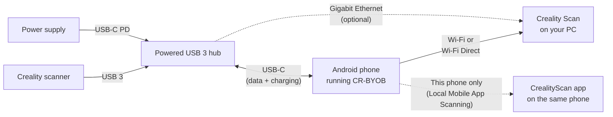

# CR-BYOB

**Bring-Your-Own-Bridge for Creality 3D scanners**

Turn an Android phone into a DIY Scan Bridge. Plug the scanner into the phone, and Creality Scan on your PC
finds it over the network like the real thing.

**[Download](https://github.com/NickLD/CR-BYOB/releases/latest)** &nbsp;·&nbsp;
[Quick start](#quick-start) &nbsp;·&nbsp;
[Supported devices](#supported-devices) &nbsp;·&nbsp;
[Using the app](docs/using-the-app.md)

&nbsp;&nbsp;&nbsp;

> [!NOTE]
> **Unofficial project.** CR-BYOB is a community project. It is not affiliated with, endorsed by or supported
> by Creality or Orbbec. "Creality", "CR-Scan", "Otter" and "Creality Scan" are trademarks of their owners and
> are used here only to describe compatibility. Use it at your own risk.

## Features

- **Meta Quest 3 / Horizon OS support:** Connect your Creality scanner (e.g. CR-Scan Raptor) directly to the Quest 3 USB-C port and use the headset as a wireless bridge over Wi-Fi 6. Declares and handles `horizonos.permission.USB_CAMERA`.
- **Works with Creality Scan as it is.** The PC discovers the phone/headset the same way it discovers a Scan Bridge.
  Nothing to install on the PC.
- **Four ways to connect:** Ethernet, Wi-Fi Direct, your home Wi-Fi, or this phone only.
- **No PC needed if you want.** *This phone only (Local Mobile App Scanning)* feeds the CrealityScan app on
  the same phone.
- **Mirror viewer.** Creality Scan's color, IR and 3D views on the phone, with Start, Pause, Finish and Delete,
  new-scan setup, fill light and exposure, and Creality Scan's messages and pop-ups.
- **Up to 30 fps (experimental).** Creality Scan asks a Scan Bridge for 15 fps from an Otter; the
  [frame-rate override](docs/using-the-app.md#scanner-frame-rate-override-experimental) gets 20 or 30 on a
  fast link, with nothing changed in Creality Scan.
- **Live dashboard.** Scanner and power status, per-stream frame rates, link quality and session statistics.
- **Updates** from GitHub Releases, downloaded and installed inside the app, with release notes after each update.

  &nbsp;&nbsp;
  
   
  Left: scanning a die grinder in a detached workshop, a separate building from the scanning PC, over a
  shared network. All three streams run at the full 15 fps. Right: the handheld rig, with the Otter, a power
  bank, a USB-C hub and the phone on a 3D-printed grip (<a href="docs/setups.md">parts and model</a>).

  
   
  Scanning an armchair over home Wi-Fi 7 with the frame-rate override on Max: all three streams at about
  30 fps. The mirror viewer shows Creality Scan's 3D, color and IR views, the scan controls, and the Wi-Fi link.

  &nbsp;&nbsp;
  
   
  Left: pick where the bridge runs. Right: session statistics, with data sent, bitrate and frame
  delivery per stream.

## Supported devices

### Scanners

| Scanner | Status |
|---|---|
| CR-Scan Otter | ✅ Tested |
| CR-Scan Otter Lite, Otter Lite Basic | ❔ Untested (same design as the Otter) |
| CR-Scan Raptor, Raptor X, Raptor Pro, Raptor Pro Max | ❔ Untested |
| CR-Scan Ferret Pro | ✅ Tested (fw 1.2.7, [device report](https://github.com/NickLD/CR-BYOB/issues/2) by [@Xalies](https://github.com/Xalies)) |
| CR-Scan Ferret | ❔ Untested (same design as the Ferret Pro) |
| Sermoon X1, Sermoon S1 | ❔ Untested |
| Sermoon P1, Sermoon P1 Lite, Creality Pika | ❌ Not supported (self-contained wireless scanners: they don't work through a Scan Bridge) |

> [!TIP]
> **Have an untested scanner?** Please try it and file a
> [Device report](https://github.com/NickLD/CR-BYOB/issues/new?template=device-report.yml), whether it works or not.
> That's how scanners move from untested to supported.

### Phones

Any Android 8+ phone with USB host (OTG) support and a **USB 3** port should work. USB 3 is required: the
scanner's streams need more bandwidth than USB 2 provides.

| Phone | Android | Ethernet | Wi-Fi | Wi-Fi Direct | This phone only (Local Mobile App Scanning) | Reported by |
|---|---|:---:|:---:|:---:|:---:|---|
| [Google Pixel 10 Pro XL](docs/phones.md#google-pixel-10-pro-xl) | 16 | ✅ | ✅ | ✅ | ✅ | [@NickLD](https://github.com/NickLD) |
| [Google Pixel 6](docs/phones.md#google-pixel-6) | 17 | — | ✅ | ✅ | — | [@Xalies](https://github.com/Xalies) |
| [Google Pixel 5](docs/phones.md#google-pixel-5) | 14 | ✅ | 🟡 | 🟡 | ⚠️ | [@NickLD](https://github.com/NickLD) |
| [Samsung Galaxy S23 Ultra](docs/phones.md#samsung-galaxy-s23-ultra) | 16 | — | — | — | ✅ | [@lihomanovdv](https://github.com/lihomanovdv) |
| [Samsung Galaxy Z Flip 8](docs/phones.md#samsung-galaxy-z-flip-8) | 17 | — | ✅ | — | — | [@SelfMadeDiesel](https://github.com/SelfMadeDiesel) |

✅ Full performance &nbsp;·&nbsp; 🟡 Works, with limits &nbsp;·&nbsp; ⚠️ Not recommended &nbsp;·&nbsp; — Not tested &nbsp;·&nbsp;
**[Notes per phone](docs/phones.md)**

> [!TIP]
> **Tested CR-BYOB on your phone?** File a [Device report](https://github.com/NickLD/CR-BYOB/issues/new?template=device-report.yml) and say
> which connections you tried, whether it worked well, poorly or not at all. Your phone gets added to this
> table, credited to your GitHub username.

## Choosing a connection

With a CR-Scan Otter at full rate the bridge sends about **265 Mbit/s** (other scanners differ;
higher-resolution ones need more), so the link matters more than the phone.

| Connection | Best for | What you need |
|---|---|---|
| **Ethernet** | The most reliable link | A powered USB-C hub with a **Gigabit** Ethernet port (100 Mbit is too slow), cabled to the router or switch your PC is on |
| **Wi-Fi Direct** | No router involved | Phone and PC with Wi-Fi 5 (802.11ac) or newer on 5 GHz, in the same room. Wi-Fi 6 or newer is better |
| **Home Wi-Fi** | Convenience | A Wi-Fi 5 or newer router on 5 GHz, with the phone close to it. On 2.4 GHz or a weak signal the frame rate drops |
| **This phone only (Local Mobile App Scanning)** | Scanning without a PC | Nothing: the video never leaves the phone |

One powered USB-C hub with Gigabit Ethernet covers it all: the scanner's USB 3 port, charging, and the wired
link. Thin, flat Ethernet cables are cheap and easy to route.

## Quick start

You need the scanner, an Android phone with a USB 3 port, and a USB 3 hub with power passthrough so the
scanner doesn't run on the phone's battery.

  
   
  A real setup, scanning the laptop on the left: the Otter goes into a USB 3 hub on the phone, a power
  bank powers both, and Creality Scan on the right laptop sees the bridge over the network.

1. Download `CR-BYOB-<version>-github.apk` from [Releases](https://github.com/NickLD/CR-BYOB/releases) and
   install it.
2. Open **CR-BYOB**, allow the permissions it explains, and plug in the scanner.
3. Pick a connection ([which one?](#choosing-a-connection)) and tap **Start**. For Wi-Fi Direct, join the
   network shown in the app from the PC's Wi-Fi menu, like any Wi-Fi network. Creality Scan's own Wi-Fi
   list won't show it ([why](docs/using-the-app.md#wi-fi-direct-not-in-creality-scan)). Once the PC is on
   it, the bridge shows up in Creality Scan by itself.
4. Start Creality Scan on the PC (or CrealityScan on the phone). The bridge shows up like a Scan Bridge.

More in [Using the app](docs/using-the-app.md).

## Security

> [!IMPORTANT]
> Like the device it replaces, the bridge's network services have no authentication: anyone on the same
> network or Wi-Fi Direct group can view the streams and send control commands. Use it on networks you trust,
> or choose **This phone only**, where only apps on the phone itself can reach it.

## Documentation

- [Using the app](docs/using-the-app.md): networks, dashboard, mirror viewer, troubleshooting
- [Phone compatibility](docs/phones.md): per-phone results on each connection
- [Setups](docs/setups.md): real rigs, with parts lists and 3D-printable mounts
- [Adding or fixing a scanner model](docs/adding-a-scanner-model.md)
- [How it works](docs/how-it-works.md)
- [Building from source](docs/building.md)
- [Changelog](CHANGELOG.md)

## Support

CR-BYOB is free. If it saved you buying a Scan Bridge and you'd like to say thanks:

## License

[MIT](LICENSE)
